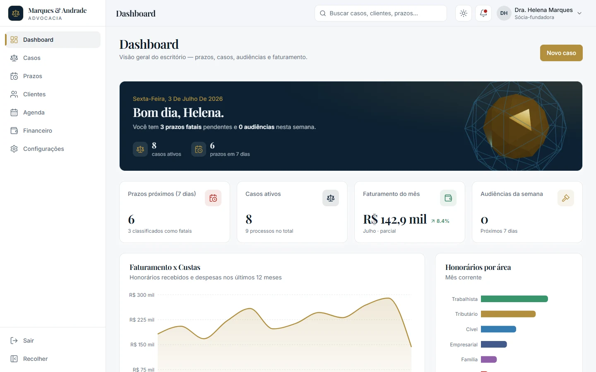
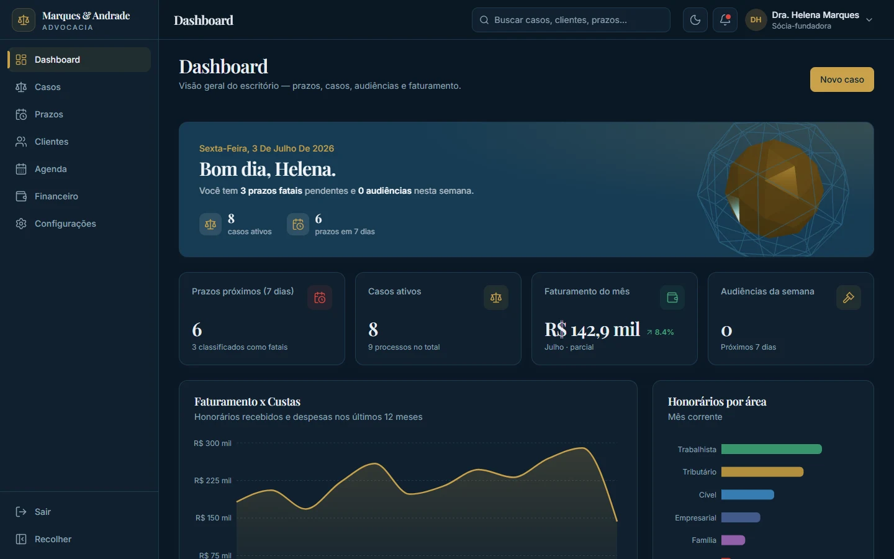
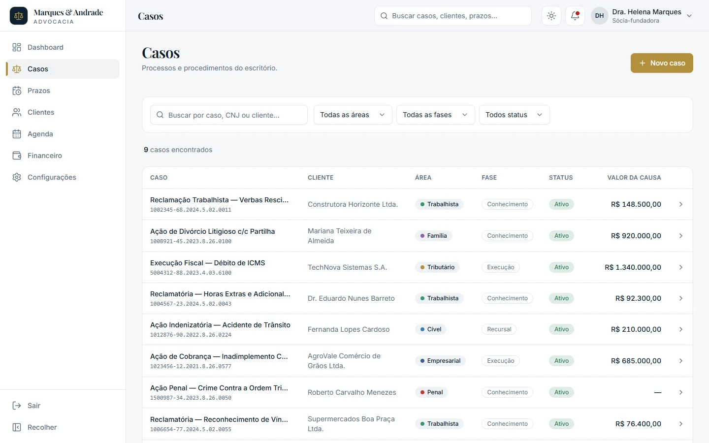
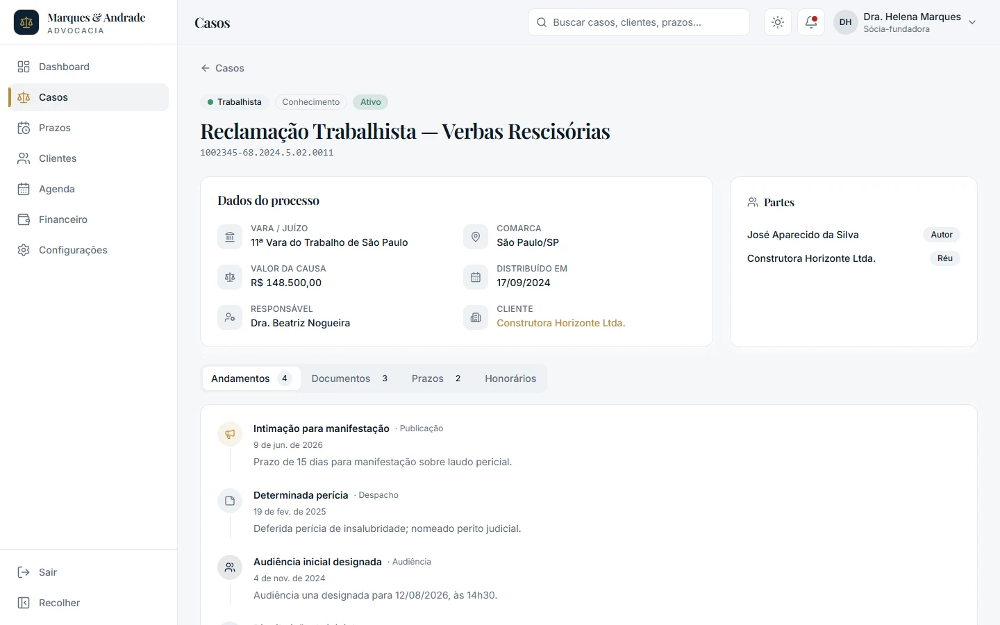
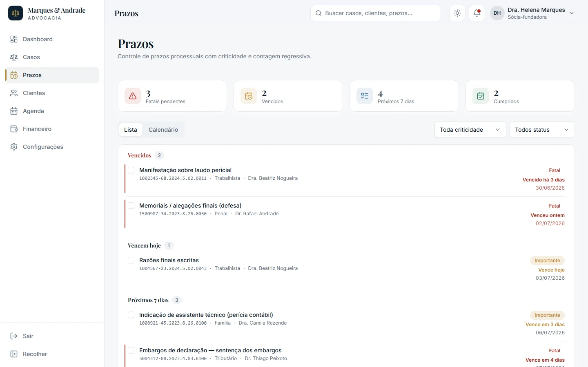
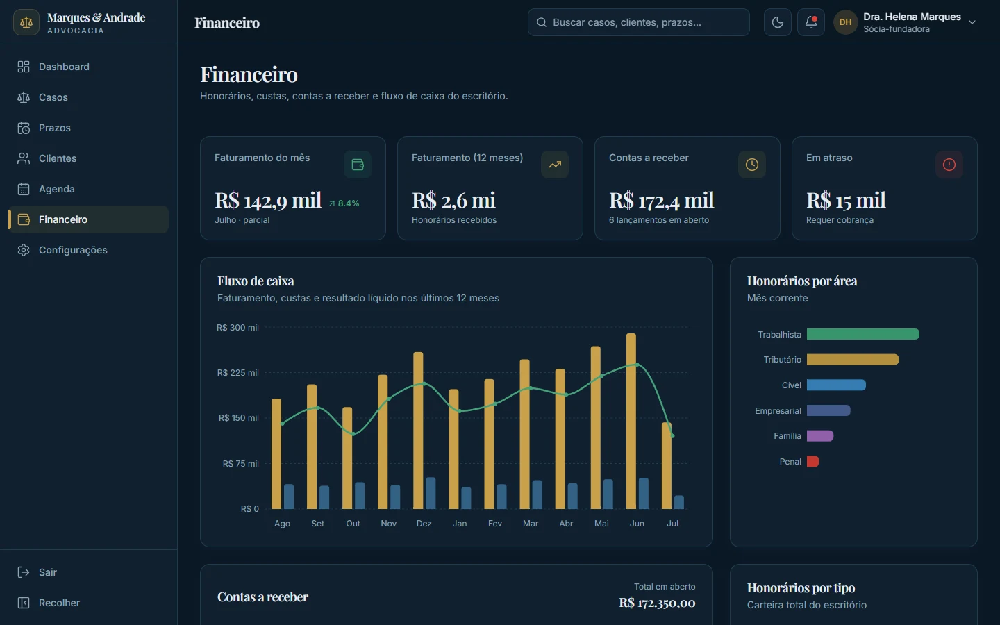
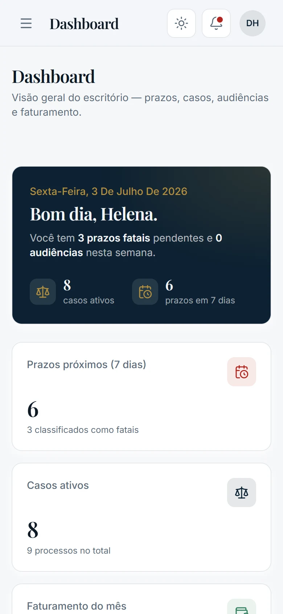

<div align="center">

# CRM Jurídico

**Gestão de processos, prazos, clientes, agenda e financeiro para escritórios de advocacia.**

[](https://github.com/VictorHaddad/crm_adv/actions/workflows/deploy.yml)


### [▶ Abrir a demo ao vivo](https://victorhaddad.github.io/crm_adv/)

<sub>Os campos de login já vêm preenchidos — é só clicar em <b>Entrar</b>.</sub>

<br>



</div>

---

## Sobre o projeto

Escritórios de advocacia de pequeno e médio porte costumam controlar prazos, processos e honorários em planilhas, agendas soltas ou sistemas datados. Perder um prazo processual tem custo alto, e a ferramenta do dia a dia raramente transmite a seriedade que o cliente espera.

Este projeto é um **protótipo de alta fidelidade** de um CRM jurídico. Ele reúne tudo isso numa interface sóbria e sofisticada, com paleta navy e dourado, tipografia serifada e foco total em clareza.

> **Status:** o front-end está completo e navegável, **sem backend**. Os dados são fictícios e ficam em [`src/data`](src/data); login, "salvar" e "cumprir prazo" são simulados.

## Funcionalidades

| Módulo | O que oferece |
|---|---|
| **Dashboard** | Saudação contextual, KPIs (prazos da semana, casos ativos, faturamento, audiências), gráfico de faturamento × custas, honorários por área, prazos urgentes e próximos compromissos |
| **Casos** | Lista com busca e filtros por área, fase e status; ficha do processo com nº CNJ, vara, comarca, valor da causa, partes e abas de **andamentos**, **documentos**, **prazos** e **honorários** |
| **Prazos** | Agrupamento por urgência (vencidos, hoje, 7 dias, adiante, cumpridos), criticidade **fatal / importante / normal**, contagem regressiva, visão de calendário e marcação de cumprimento |
| **Clientes** | Cadastro PF/PJ com CPF/CNPJ formatados, contatos, casos vinculados e histórico consolidado de andamentos |
| **Agenda** | Audiências, reuniões e compromissos em lista por dia ou calendário mensal, com vínculo ao processo |
| **Financeiro** | Fluxo de caixa (12 meses), contas a receber com destaque para atrasos, honorários por área e por tipo |
| **Configurações** | Dados do escritório, tema claro/escuro e gestão da equipe |
| **Login** | Tela de acesso com cena 3D sutil e opção de certificado digital |

Áreas do direito cobertas nos dados: Cível, Trabalhista, Tributário, Penal, Família e Empresarial.

## Galeria

<table>
  <tr>
    <td width="50%"><br><sub><b>Login</b> — cena 3D em Three.js</sub></td>
    <td width="50%"><br><sub><b>Dashboard</b> — tema escuro</sub></td>
  </tr>
  <tr>
    <td width="50%"><br><sub><b>Casos</b> — busca e filtros</sub></td>
    <td width="50%"><br><sub><b>Ficha do processo</b> — dados, partes e andamentos</sub></td>
  </tr>
  <tr>
    <td width="50%"><br><sub><b>Prazos</b> — criticidade e contagem regressiva</sub></td>
    <td width="50%"><br><sub><b>Financeiro</b> — fluxo de caixa e honorários</sub></td>
  </tr>
</table>

<p align="center">
  <br>
  <sub><b>Mobile</b> — layout responsivo com menu em gaveta</sub>
</p>

## Destaques de UX e engenharia

- **Design system por tokens:** cores semânticas em CSS variables (HSL), com tema claro e escuro, sem hex cru nos componentes.
- **Responsivo de verdade:** sidebar colapsável no desktop e gaveta no mobile; tabelas viram cards em telas pequenas.
- **Movimento com propósito:** transições de página e micro-interações com Framer Motion; o 3D é lento e de baixo contraste, e tudo respeita `prefers-reduced-motion`.
- **Acessibilidade:** foco visível, `aria-label` em ações com ícone, contraste AA e navegação por teclado.
- **Performance:** code-splitting por rota e carregamento sob demanda do Three.js. O bundle inicial tem ~375 kB (~120 kB gzip); o 3D só baixa no Login e no Dashboard.
- **Domínio brasileiro:** formatação centralizada de moeda (BRL), datas pt-BR, CPF/CNPJ e contagem regressiva de prazos.

## Stack

| Camada | Tecnologia |
|---|---|
| Base | [Vite](https://vite.dev) · [React 19](https://react.dev) · [TypeScript](https://www.typescriptlang.org) |
| Estilo | [Tailwind CSS 3](https://tailwindcss.com) com tokens em CSS variables |
| Componentes | [shadcn/ui](https://ui.shadcn.com) (estilo *new-york*) sobre [Radix UI](https://www.radix-ui.com) |
| Animação | [Framer Motion](https://motion.dev) |
| 3D | [Three.js](https://threejs.org) · [React Three Fiber](https://r3f.docs.pmnd.rs) · drei |
| Gráficos | [Recharts](https://recharts.org) |
| Rotas | [React Router 7](https://reactrouter.com) |
| Datas e ícones | [date-fns](https://date-fns.org) · [Lucide](https://lucide.dev) |
| Qualidade | [Oxlint](https://oxc.rs) · GitHub Actions |

## Como rodar localmente

**Pré-requisito:** Node.js 20.19+ (recomendado 24, ver [`.nvmrc`](.nvmrc)).

```bash
git clone https://github.com/VictorHaddad/crm_adv.git
cd crm_adv
npm install
npm run dev
```

Acesse http://localhost:5173. O app abre em `/login`; clique em **Entrar**.

| Script | Função |
|---|---|
| `npm run dev` | Servidor de desenvolvimento com HMR |
| `npm run build` | Type-check (`tsc -b`) + build de produção em `dist/` |
| `npm run preview` | Serve o build de produção localmente |
| `npm run lint` | Análise estática com Oxlint |

## Estrutura do projeto

```
src/
├── app/            # rotas, providers e itens de navegação
├── components/
│   ├── ui/         # primitivos shadcn/ui (button, card, select…)
│   ├── layout/     # AppShell, Sidebar, Topbar, PageHeader
│   ├── common/     # KpiCard, EmptyState, badges…
│   ├── charts/     # gráficos Recharts
│   └── three/      # cenas 3D (Login e Dashboard)
├── features/       # uma pasta por tela: auth, dashboard, cases, deadlines,
│                   # clients, agenda, finance, settings
├── data/           # dados fictícios + seletores derivados
├── types/          # tipos de domínio (LegalCase, Client, Deadline…)
├── lib/            # cn(), formatadores pt-BR, constantes
└── hooks/          # tema, media query, cores de gráfico
```

Os dados seguem um fluxo único: `data/*.ts` (mocks) → `data/index.ts` (seletores) → `features/` (telas) → `components/` (UI). Nenhuma tela reimplementa formatação nem usa cores fixas.

A documentação técnica completa, com cada etapa de construção e a função de cada arquivo, está em **[DOCUMENTACAO.md](DOCUMENTACAO.md)**.

## Dados de demonstração

Todos os nomes, empresas, processos e valores são **fictícios**:

- CPF, CNPJ e números de processo (CNJ) têm **dígitos verificadores propositalmente inválidos**, para não coincidirem com pessoas, empresas ou processos reais.
- Os domínios de e-mail não estão registrados.
- A data de referência é fixa (**03/07/2026**, em `src/data/index.ts`), para manter prazos e agenda coerentes em qualquer dia da demonstração.

## Deploy

Cada push na `main` dispara o [workflow de deploy](.github/workflows/deploy.yml), que roda lint e build e publica no **GitHub Pages**. O caminho base (`/crm_adv/`) é injetado no build via `BASE_PATH`, e um `404.html` garante que links diretos para qualquer tela funcionem. Pull requests passam pelo [CI](.github/workflows/ci.yml) (lint + build).

## Limitações e próximos passos

Por ser um protótipo, ainda não há:

- backend, banco de dados e persistência real;
- autenticação, perfis de acesso e multiusuário;
- busca global e notificações funcionais (hoje são ilustrativas);
- integrações com tribunais e captura automática de publicações.

---

<sub>Sem licença de uso: todos os direitos reservados. O código está público apenas para fins de demonstração.</sub>
